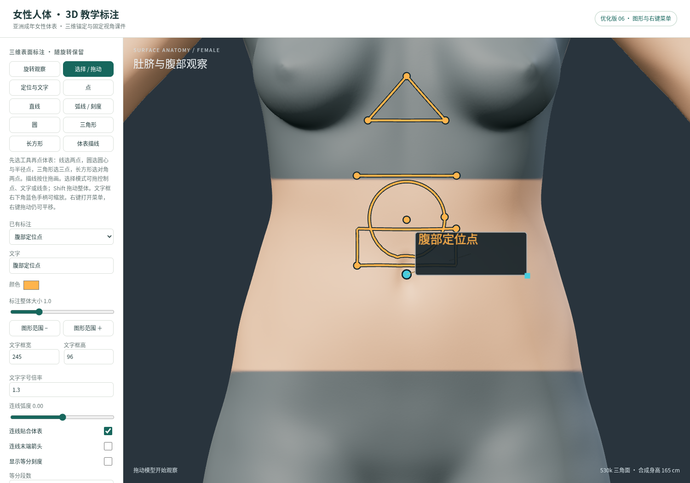
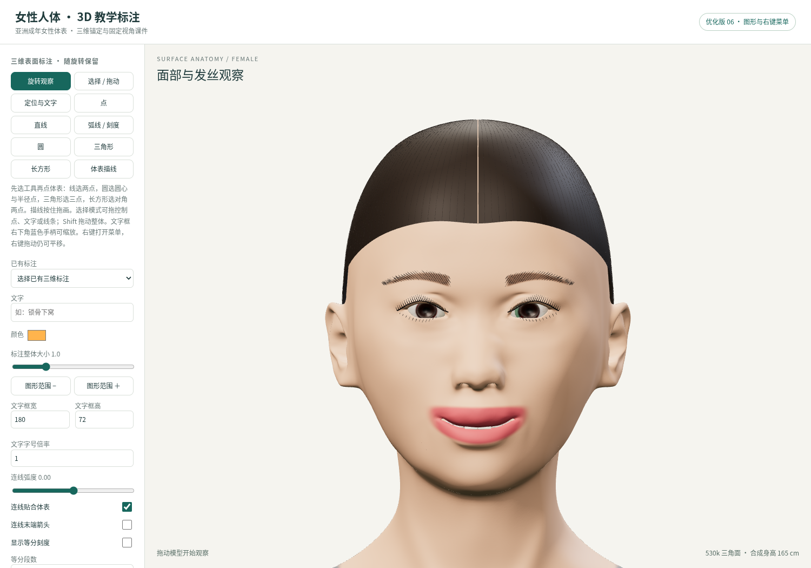
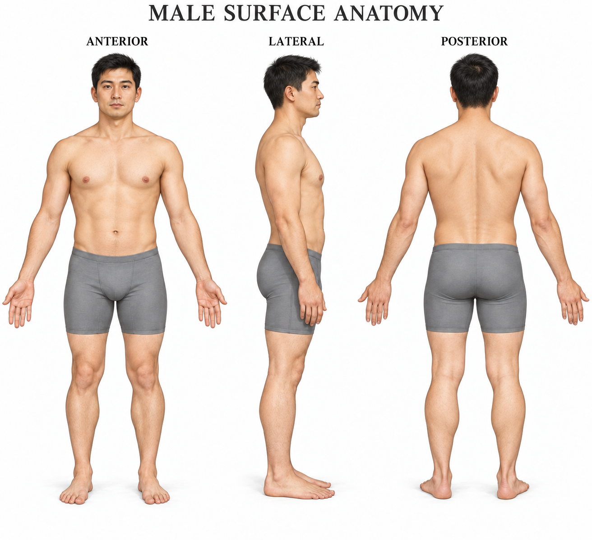
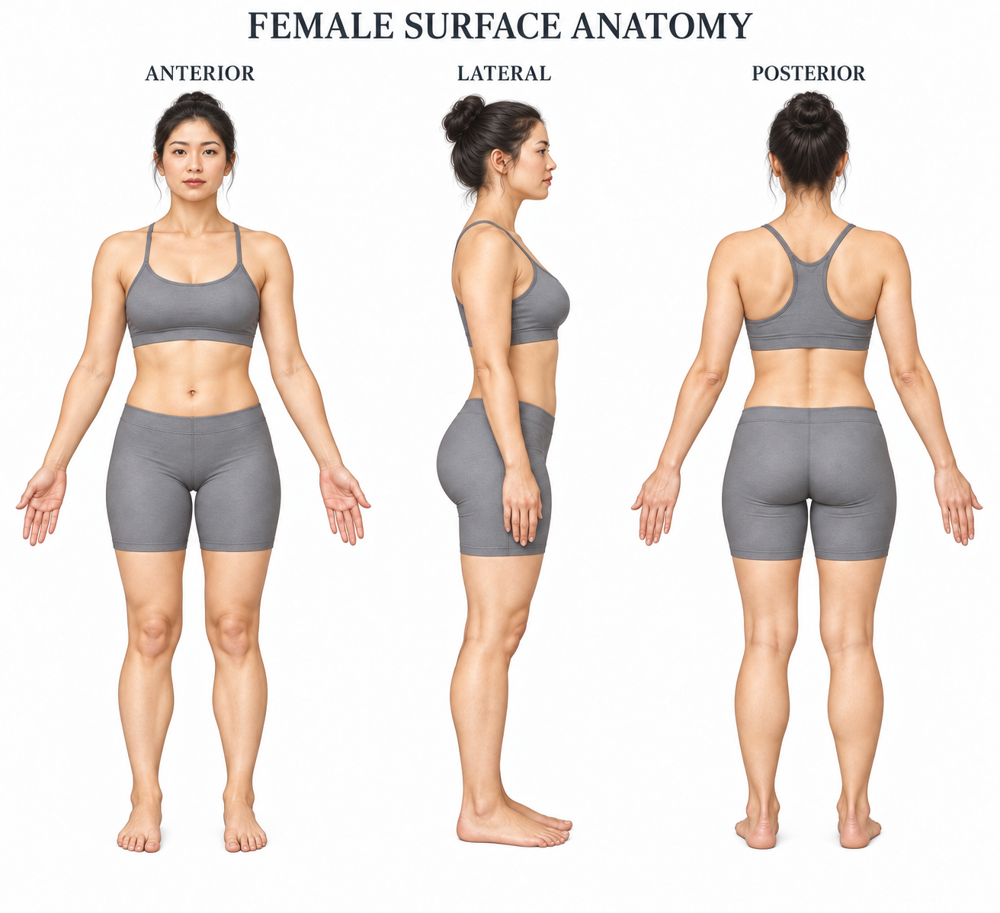
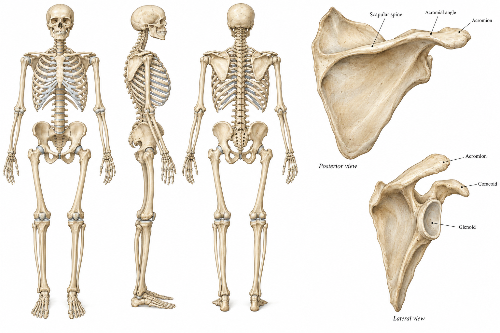

# 医学人体三视图

直接在本仓库首页向下滚动即可查看图片；点击图片可打开原图并放大。

## 女性 3D 交互样稿

已提供亚洲成年女性体表的真实三维网格与离线查看器，可旋转、缩放、平移、切换标准视角、聚焦肩背、查看线框、测量两点直线距离，并导出 4K PNG。

**优化版 06**：增加点、直线、圆、三角形和长方形等三维标注工具；支持视图与标注右键菜单、重命名和删除。文字框可用角部手柄缩放，宽、高、字号可分别修改，指针线更细。头像参考本次附件调整中分发型、脸型、眉眼与微笑，支持导入 05 版三维课件。[使用说明与功能边界](female-3d/图形工具与优化版06.md)。

同时保留**二维截图板书**：画笔、荧光笔、箭头、形状、文字、移动、擦除、撤销重做、多页课件，以及可编辑 `.excalidraw` 导出。这套二维笔迹绑定视角快照；三维锚定标注请使用查看器上方的新工具，两类课件分别保存。

- [教学版预览](female-3d/previews/teaching-viewer.png) · [可编辑示例](female-3d/previews/teaching-demo.excalidraw)
- [Obsidian / Excalidraw 使用教程](female-3d/Obsidian与Excalidraw教学.md) · [Obsidian 网页嵌入示例](female-3d/obsidian-live-embed.excalidraw)

**[下载离线包](female-3d-offline.zip)** → 解压 → 用 Chrome / Edge 打开其中的 `female-3d/female-3d.html`。GitHub 文件页面和聊天窗口不能直接运行该查看器。

新版离线包用于查看和教学，不再重复打包已内嵌在 HTML 中的原始模型；GLB、Blender 文件及开发源代码可从仓库独立下载。

- [打开说明](female-3d/打开说明.md) · [GLB 模型](female-3d/assets/asian-female.glb) · [Blender 可编辑文件](female-3d/assets/asian-female.blend)
- [正面预览](female-3d/previews/viewer-front.png) · [背面预览](female-3d/previews/viewer-back.png) · [肩背局部](female-3d/previews/viewer-shoulder.png)
- [来源与许可](female-3d/THIRD_PARTY_NOTICES.md) · [验证范围](female-3d/VALIDATION.md)

本版是体表概念样稿，不含内部骨骼，尚未经专业解剖校核；体表细分网格的平滑度不等于医学细节准确性。

## A3 印刷文件

新增 **[男女精绘与 600 DPI 文件](print-600dpi/README.md)**：6 张独立全身重绘、4 张上半身/下肢精绘、两张 3072 × 1616 三视图拼版；本版统一为 **20–25 岁成年青年**，女性采用不透明无肩带胸部遮盖、开放后背和较短运动短裤。另提供 A3、9921 × 7016 的 600 DPI 输出。A3 文件含插值，原生像素及实际可印尺寸在说明中逐项列出。

已提供三张精修图的 **4961 × 3508 像素、300 DPI、A3 横版**文件，采用 sRGB 色彩配置、等比例排版、约 10 mm 以上白边，不裁切人物。

- [三页 A3 PDF](print/anatomy-plates-A3-300dpi.pdf)
- 亚洲男性：[PNG](print/male-A3-300dpi.png) · [无损 TIFF](print/male-A3-300dpi.tif)
- 亚洲女性：[PNG](print/female-A3-300dpi.png) · [无损 TIFF](print/female-A3-300dpi.tif)
- 骨骼与肩胛骨细节：[PNG](print/skeleton-A3-300dpi.png) · [无损 TIFF](print/skeleton-A3-300dpi.tif)
- [印刷说明与清晰度限制](print/README.md)

## 亚洲男性体表三视图

## 亚洲女性体表三视图

## 骨骼三视图及肩胛骨细节

以上为 AI 生成的医学插图初稿，尚未经专业解剖校核。
